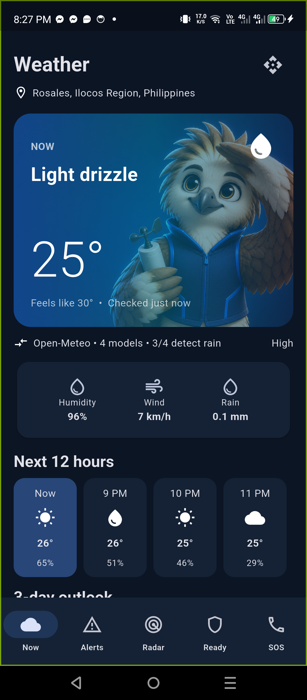
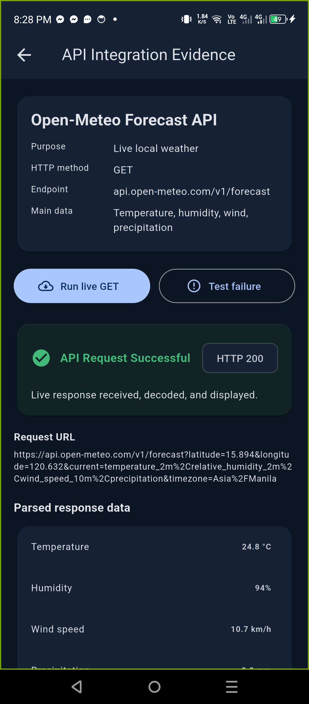
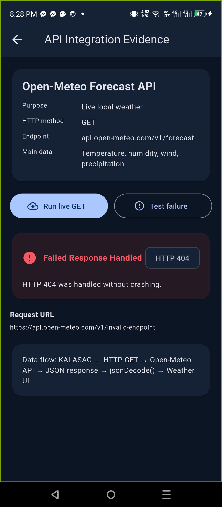

# CC106 M4 L1 Laboratory Activity 1

## API Integration — KALASAG

**Name:** ______________________________  
**Course / Year / Block:** ______________________________  
**Date:** ______________________________

## Final-Project Feature

KALASAG uses an external weather service to display current weather and forecast
information for the user's location. This supports the existing Weather
dashboard and helps users prepare for rain, strong winds, and other conditions.

## Short API Integration Summary

| Required item | KALASAG implementation |
|---|---|
| API/service name | Open-Meteo Forecast API |
| Purpose in the project | Supplies live local weather data for the Weather dashboard |
| Endpoint used | `https://api.open-meteo.com/v1/forecast` |
| HTTP method | `GET` |
| Main response data used | Current temperature, relative humidity, weather code, wind speed, precipitation, hourly forecast, and daily forecast |
| Final-project feature | Weather/Home dashboard and API Integration Evidence screen |
| POST request | Not implemented because the public forecast API is read-only and the app does not need to create or modify server data |

## Request and Response Handling

The application creates an HTTPS URI with latitude, longitude, requested
weather variables, timezone, and forecast options. It sends the request using
`http.get()`, checks the HTTP status, and decodes the JSON body using
`jsonDecode()`. The parsed values are displayed as weather cards, metrics,
hourly forecasts, and daily forecasts.

- **Loading:** A progress indicator is shown while waiting for the API.
- **Success:** HTTP 200 and parsed weather values are displayed.
- **Error:** A non-200 response or network exception displays an error without
  crashing the application.

## Simple Data-Flow Diagram

```text
┌──────────────────┐
│ KALASAG Flutter  │
└────────┬─────────┘
         │ HTTPS GET request
         ▼
┌──────────────────┐
│ Open-Meteo API   │
└────────┬─────────┘
         │ HTTP response + JSON
         ▼
┌──────────────────┐
│ Status checking  │
│ and jsonDecode() │
└────────┬─────────┘
         │ Parsed weather values
         ▼
┌──────────────────┐
│ Weather dashboard│
└──────────────────┘
```

## Required Screenshots

### 1. Final-project screen using API data



### 2. Evidence of a successful API response



### 3. Error handling / failed-response state



## Source Locations

- API request and response parsing: `lib/services.dart`
- Weather dashboard using parsed data: `lib/screens.dart`
- Success/failure evidence screen: `lib/api_activity_screen.dart`
- Loading and error state: `lib/app_state.dart`

## Submission Link

https://github.com/cathan29/KALASAG-in-Flutter
